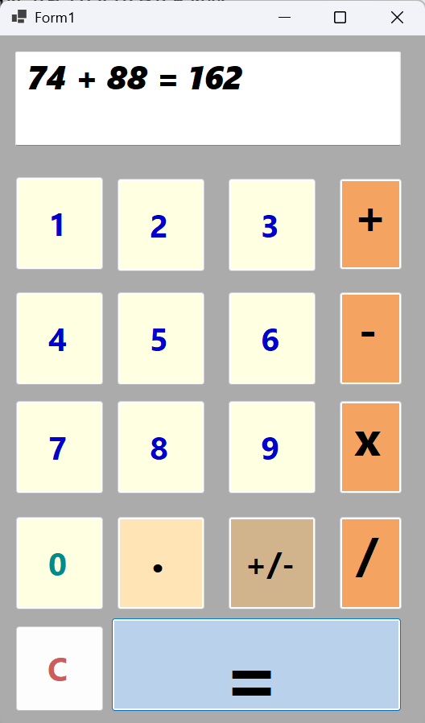

# Calculator – C# Windows Forms

Ein Taschenrechner, der mit C# und Windows Forms entwickelt wurde.

## Funktionen

- Addition, Subtraktion, Multiplikation und Division
- Berücksichtigung der Rechenreihenfolge (Punkt vor Strich)
- Berechnungen mit negativen Zahlen
- Unterstützung von Dezimalzahlen
- Grafische Benutzeroberfläche mit Windows Forms

## Verwendete Technologien

- C#
- .NET
- Windows Forms
- Visual Studio

## Projektziel

Ziel des Projekts war es, die Grundlagen der C#-Programmierung sowie die Entwicklung grafischer Benutzeroberflächen und die Verarbeitung mathematischer Ausdrücke praktisch anzuwenden.
